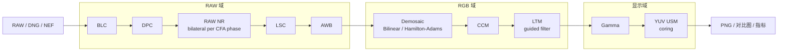
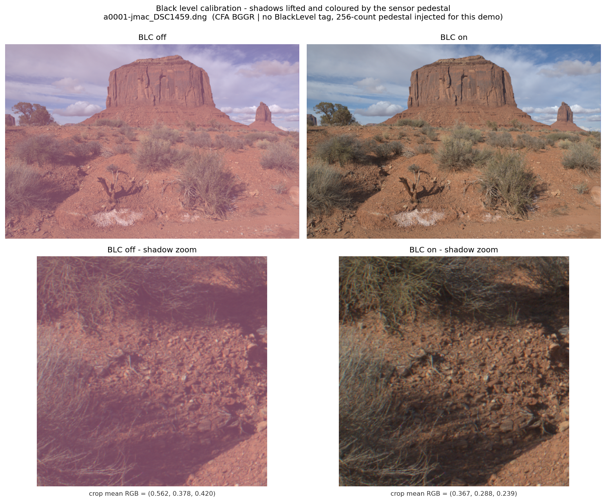
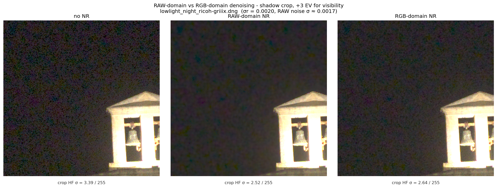
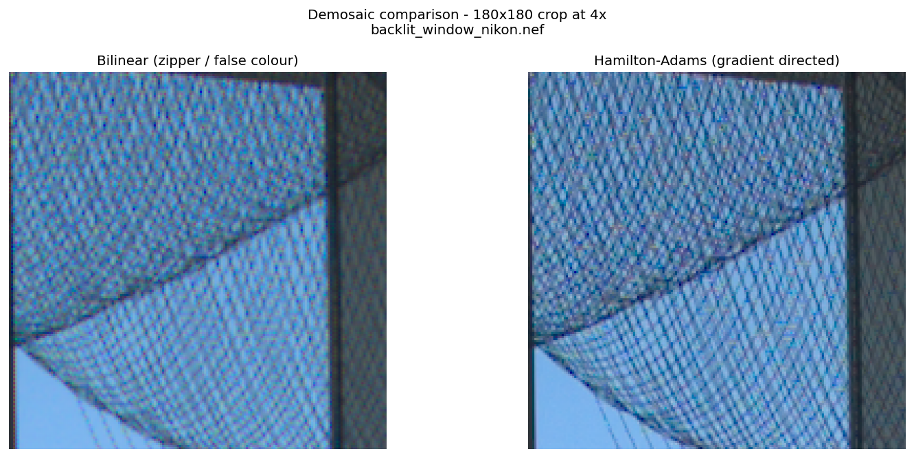
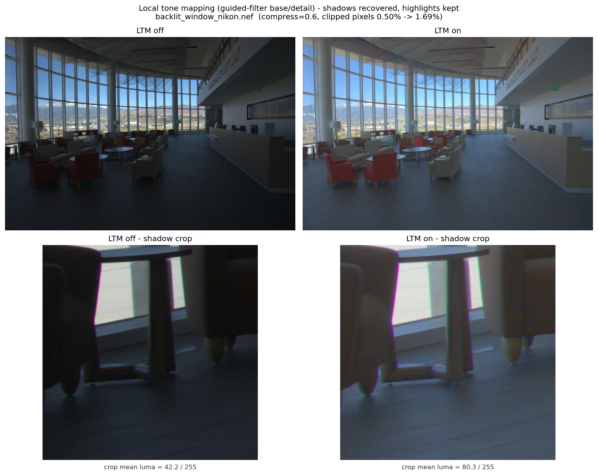

# Simple-ISP-pipeline
```markdown
# 端到端软件 ISP Pipeline 仿真与画质增强系统 — 完整开发大纲

## 阶段一：仓库初始化与数据解析验证（Day 1）

### 1. 本地仓库与目录结构搭建
在本地初始化 Git 仓库并关联 GitHub 远程仓库（`Simple-ISP-pipeline`），生成标准模块化目录：
```text
Simple-ISP-pipeline/
├── data/                  # 存放测试用的 .dng 原图（大文件通过 .gitignore 忽略）
├── results/               # 存放各模块处理前后的对比图（用于 README 展示）
├── modules/               # 核心算法模块
│   ├── __init__.py
│   ├── blc.py             # 黑电平校准
│   ├── dpc.py             # 坏点校正
│   ├── lsc.py             # 镜头阴影校正
│   ├── raw_nr.py          # RAW 域自适应降噪
│   ├── awb.py             # 自动白平衡
│   ├── demosaic.py        # 去马赛克（CFA 插值）
│   ├── ccm_gamma.py       # 颜色校正矩阵与 Gamma 校正
│   └── yuv_post.py        # 局部色调映射（LTM）与 YUV 锐化
├── utils/
│   └── metrics.py         # 客观画质指标评估（PSNR / SSIM / Delta E）
├── main.py                # 主流水线串联与可视化入口
├── requirements.txt       # 依赖列表（numpy, opencv-python, rawpy, scipy, matplotlib）
├── .gitignore             # 忽略缓存及大体积 RAW 原图
└── README.md              # 项目说明文档与对比效果展示

```

### 2. 测试数据准备与元数据解析

* **数据获取**：准备 2 张 `.dng` 格式原始图像（建议 1 张**室内低照度高噪点场景**，1 张**逆光高反差窗边场景**）。
* **元数据解析验证**：利用 `rawpy` 读取原始数据与传感器 EXIF 标定参数并打印核对：
* `raw_image`（二维单通道 Bayer 矩阵）
* `raw_pattern`（CFA 排列相位，如 RGGB / BGGR）
* `black_level_per_channel`（R/Gr/Gb/B 四通道黑电平偏置）
* `white_level`（传感器饱和白电平）
* `camera_whitebalance`（相机出厂白平衡增益）
* `color_matrix`（$3 \times 3$ 色彩校正矩阵）


* **Git 提交节点**：`feat: setup project structure and raw dng parser`

---

## 阶段二：打通最小可行性流水线 MVP（Day 2 ~ Day 3）

### 1. 基础模块开发（全程使用 `float32` 运算）

* **`blc.py`（黑电平校准）**：依据 `raw_pattern` 相位，分别扣除 R、Gr、Gb、B 四个通道对应的黑电平偏置，并归一化至 $[0, 1]$ 浮点区间。
* **`dpc.py`（坏点校正）**：在 RAW 图上随机注入死点（0）与热点（1）进行测试，实现 $5 \times 5$ 同色通道邻域极值检测与中值替换。
* **`lsc.py`（镜头阴影校正）**：基于像素到图像中心的归一化距离 $r$，构造径向增益补偿曲面 $G(r) = 1 + k_1 r^2 + k_2 r^4$，消除画面四周暗角。
* **`awb.py`（自动白平衡）**：支持两种模式切换——直接应用 EXIF 读取的白平衡增益，以及手写灰度世界法（Gray World）自动估算增益。
* **`demosaic.py`（基础版）**：实现基础双线性插值（Bilinear Interpolation），将单通道 Bayer 阵列重构为三通道 RGB 图像。
* **`ccm_gamma.py`（颜色校正与伽马）**：执行 $3 \times 3$ CCM 矩阵乘法（执行 `np.clip(img, 0.0, 1.0)` 防止负值导致后续幂运算出错），施加 sRGB Gamma 曲线 $I_{out} = I_{in}^{1/2.2}$ 并量化为 `uint8` 输出。

### 2. 阶段性可视化验证

* 运行流水线生成首张正常出图，并保存“关闭 BLC（暗部泛紫发灰）”与“开启 BLC（暗部纯净）”的对比图至 `results/blc_comparison.png`。
* **Git 提交节点**：`feat: implement end-to-end baseline ISP pipeline (BLC to Gamma)`

---

## 阶段三：核心痛点算法升级与指标量化（Day 4 ~ Day 5）

### 1. RAW 域自适应降噪（`raw_nr.py`）

* **核心策略**：将单通道 Bayer 图像按相位拆分为 4 张半分辨率同色子图（R、Gr、Gb、B），对各子图分别施加双边滤波（Bilateral Filter）后再拼回原位，杜绝跨通道颜色串扰。
* **对比验证**：对比“RAW 域降噪”与“Demosaic 之后在 RGB 域降噪”的暗部放大效果，保存为 `results/nr_comparison.png`。

### 2. 梯度导向去马赛克（`demosaic.py` 进阶版）

* **核心策略**：实现 **Hamilton-Adams 梯度导向插值**——计算水平与垂直二阶梯度，沿梯度较小的边缘方向插值重建 G 通道；利用色差恒定假设（$R-G$、$B-G$ 在局部平滑）恢复 R/B 通道，并辅以色差中值滤波抑制伪彩。
* **对比验证**：截取建筑边缘或高频纹理区域，保存“双线性插值（拉链效应）”与“梯度导向插值”的局部放大对比图 `results/demosaic_comparison.png`。

### 3. 局部色调映射与 YUV 域锐化（`yuv_post.py`）

* **LTM（局部色调映射）**：在 Gamma 之前引入**引导滤波（Guided Filter）**，将图像分解为照度基础层与反射细节层，压缩基础层动态范围并保留细节，解决逆光场景高光过曝与暗部死黑问题，保存对比图 `results/ltm_comparison.png`。
* **EE（边缘增强）**：转换至 YUV 空间，仅对亮度通道（Y）执行带降噪门限（Coring）的反锐化掩模（USM）锐化，避免放大暗部颗粒噪点。

### 4. 客观画质评测（`utils/metrics.py`）

* 以 `rawpy.postprocess()` 渲染结果作为参考基准，计算 Baseline 与优化版本在测试集上的 **PSNR**、**SSIM** 及色彩还原误差（$\Delta E_{2000}$）。
* **Git 提交节点**：`feat: upgrade to edge-directed demosaic, RAW-domain NR, and LTM`

---

## 阶段四：C++ 算子加速与项目文档完善（Day 6 ~ Day 7）

### 1. C++ 核心算子性能优化

* 选取耗时最高的双边滤波或梯度导向插值算子，使用 C++ 重写滑动窗口核心逻辑（通过 `pybind11` 或 `ctypes` 编译供 Python 调用）。
* 引入 `#pragma omp parallel for` 开启 OpenMP 多核并行加速，实测并记录单帧处理耗时的前后对比数据。
* **Git 提交节点**：`perf: accelerate demosaic and bilateral filter with C++ and OpenMP`

### 2. 完善 `README.md` 作品集展示

* 嵌入完整的 ISP Pipeline 架构流程图。
* 展示 4 组核心可视化对比图（BLC 校准、RAW-NR 降噪、Demosaic 去伪彩、LTM 动态范围压缩）。
* 整理客观指标（PSNR/SSIM）与单帧处理耗时对比表格。
* 编写清晰的环境配置与一键运行指令。
* **Git 提交节点**：`docs: add visual comparisons, benchmark metrics, and architecture diagram in README`

---

## 工程开发避坑清单

1. **数值溢出与 `NaN` 防护**：全程保持 `float32` 精度；CCM 矩阵非对角线含负数，暗部噪点易产生负值，Gamma 幂运算前必须执行 `np.clip(img, 0.0, 1.0)` 截断。
2. **相位对齐一致性**：在 BLC、DPC、RAW-NR 拆分通道时，严格依据 `raw_pattern` 索引对应的 R/Gr/Gb/B 坐标，防止相位错位引发严重偏色。
3. **版本控制规范**：按上述 4 个阶段分批提交代码，保持清晰、可追溯的 Git Commit 迭代历史。

---

## 当前进度与运行方式

### 阶段进度

| 阶段 | 内容 | 状态 |
| --- | --- | --- |
| 阶段一 | 仓库结构 + DNG 解析与元数据核对 | ✅ 完成 |
| 阶段二 | BLC → DPC → LSC → AWB → 双线性去马赛克 → CCM/Gamma 全链路 | ✅ 完成 |
| 阶段三 | RAW 域降噪 / Hamilton-Adams 去马赛克 / LTM / YUV 锐化 / 指标评测 | ✅ 完成 |
| 阶段四 | C++ + OpenMP 算子加速 / 文档与架构图 | ✅ 完成 |

### 环境准备

`rawpy` / `opencv-python` 目前没有 Python 3.14 的预编译轮子，建议用 Python 3.9 ~ 3.12 建虚拟环境（本机实测：Python 3.9.6 + numpy 2.0.2 + opencv 5.1.0 + rawpy 0.27.1 + scipy 1.13.1）。

```bash
python3 -m venv .venv
source .venv/bin/activate
pip install -r requirements.txt
```

### 1. 核对 RAW 元数据（阶段一）

```bash
python -m tools.inspect_raw data/a0001-jmac_DSC1459.dng
# 可选：同时导出 JSON
python -m tools.inspect_raw data/*.dng --json results/dng_metadata.json
```

会打印 `raw_image` 形状、CFA 排列（`BGGR`）、四通道黑电平、白电平、相机白平衡增益、DNG ColorMatrix2 以及推导出的 CCM。

### 2. 运行完整流水线（阶段二）

```bash
python main.py                                # 处理 data/ 下所有 RAW（默认相机白平衡）
python main.py --awb gray_world               # 灰度世界法自动白平衡
python main.py --lsc auto                     # 自动估计径向阴影系数（需平坦场景假设）
python main.py --no-dpc --no-comparison       # 关闭坏点校正 / 跳过对比图
```

输出：

* `results/<文件名>_isp.png`：流水线最终出图（全分辨率约 10 MB，已加入 `.gitignore`，运行即可复现）；
* `results/blc_comparison.png`：BLC 开关对比图（整图 + 暗部放大 + 裁剪区均值 RGB）。

### 3. 阶段三：核心算法升级与指标量化

```bash
# RAW 域降噪（夜间高 ISO 场景）
python main.py --input data/lowlight_night_ricoh-griiix.dng \
    --raw-nr --demosaic hamilton --sharpen --figures nr

# 梯度导向去马赛克（窗框 / 高频纹理）
python main.py --input data/backlit_window_nikon.nef --demosaic hamilton --figures demosaic

# 局部色调映射（逆光窗边）
python main.py --input data/backlit_window_nikon.nef --ltm --ltm-compress 0.6 --figures ltm

# 客观指标：以 rawpy.postprocess 渲染为参考（含全局曝光对齐）
python main.py --input data/backlit_window_nikon.nef --demosaic hamilton --metrics
```

新增开关：`--raw-nr` / `--raw-nr-strength` / `--raw-nr-sigma`、`--demosaic {bilinear,hamilton}`、
`--ltm` / `--ltm-compress` / `--ltm-radius`、`--sharpen` / `--sharpen-amount` / `--sharpen-coring`、
`--figures {nr,demosaic,ltm,blc,all}`、`--metrics`。

#### 3.1 三个核心算法

| 模块 | 实现要点 |
| --- | --- |
| `raw_nr.py` | 按 CFA 相位拆成 R/Gr/Gb/B 四个半分辨率子图，各自做双边滤波再拼回；`σr` 由 96×96 分块噪声估计（同色相邻差 + MAD，取 75 分位）自适应得到 |
| `demosaic.py` | Hamilton-Adams：在 R/B 位置比较水平/垂直二阶梯度，沿较小方向插值 G 并加 Laplacian 修正；再用色差恒定假设插值 R−G、B−G，并对插值色差做 3×3 中值滤波抑制伪彩 |
| `yuv_post.py` | 引导滤波把 log 亮度分解为基础层 + 细节层，压缩基础层（`compress=0.6`）后按比例回填 RGB；Gamma 后在 YUV 域仅对 Y 做带 coring 死区的 USM 锐化 |

#### 3.2 合成真值验证（排除参考色调干扰）

把 libraw 渲染的线性 RGB 当作真值 → 按 CFA 采样回马赛克 → 重建，比较重建结果：

| 场景 | 双线性 | Hamilton-Adams | 提升 |
| --- | --- | --- | --- |
| Z6 窗边 | 36.92 dB / SSIM 0.9699 | **41.46 dB / SSIM 0.9851** | +4.54 dB |
| D70 户外 | 36.84 dB / SSIM 0.9316 | **40.01 dB / SSIM 0.9705** | +3.17 dB |

降噪（向真值马赛克加入 σ=0.01 高斯噪声，σr=0.015，对比干净重建）：

| 场景 | 无降噪 | RAW 域降噪 | Demosaic 后 RGB 域降噪 |
| --- | --- | --- | --- |
| Z6 窗边 | 39.91 dB / 0.9323 | **42.57 dB / 0.9686** | 40.69 dB / 0.9452 |
| D70 户外 | 39.37 dB / 0.9541 | **39.81 dB / 0.9610** | 39.58 dB / 0.9575 |

复现命令：`python -m tools.validate_stages --input <raw> --crop 400 1400 800 2000`

#### 3.3 与 libraw 参考的客观指标

（`rawpy.postprocess(use_camera_wb=True, no_auto_bright=True)`，评测前做全局曝光对齐；运行 `--metrics` 会写出 `results/metrics.json`）

| 场景 | 配置 | PSNR (dB) | SSIM | ΔE₀₀ mean | ΔE₀₀ p95 |
| --- | --- | --- | --- | --- | --- |
| D70 户外 | Baseline（双线性） | 22.99 | 0.8386 | 6.60 | 12.19 |
| D70 户外 | + Hamilton-Adams | **23.40** | **0.9059** | **6.02** | **9.68** |
| Z6 逆光窗边 | Baseline | 20.54 | 0.4855 | 6.93 | 10.61 |
| Z6 逆光窗边 | + Hamilton-Adams | **20.64** | **0.5037** | **6.55** | **10.32** |
| Ricoh 夜间 | Baseline | 27.66 | 0.4465 | 3.19 | 7.17 |
| Ricoh 夜间 | + Hamilton-Adams + RAW NR | 27.66 | 0.4343 | **2.83** | **6.77** |

> 说明：libraw 参考自身带噪声与不同的高光处理，因此“去噪”后与参考的 SSIM 不一定上升，NR 的收益应看合成真值表与 `nr_comparison.png` 的 HF σ；LTM 属于主观风格化处理，会主动改变色调映射，故未列入参考指标对比（其效果见 3.4 的暗部亮度与高光裁切统计）。

#### 3.4 可视化对比

* `results/nr_comparison.png`：夜间暗部 +3 EV 放大，HF σ 3.39 → RAW 域 2.52 / RGB 域 2.64，且 RAW 域无明显色斑；
* `results/demosaic_comparison.png`：窗框/网格高频区域 4× 放大，双线性出现拉链与伪彩，Hamilton-Adams 明显更干净；
* `results/ltm_comparison.png`：逆光窗边暗部平均亮度 42.2 → 80.3（/255），高光裁切 0.50% → 1.69%，室内细节恢复且窗外不过曝。

### 测试数据（本地文件，已被 `.gitignore` 忽略）

| 文件 | 相机 / 格式 | 场景 | 用途 |
| --- | --- | --- | --- |
| `a0001-jmac_DSC1459.dng` | Nikon D70 / DNG | Monument Valley 户外高反差、细节丰富 | BLC、去马赛克、CCM 基线验证 |
| `backlit_window_nikon.nef` | Nikon Z 6 / NEF | 室内大厅逆光窗边：室内极暗、窗外雪山强光 | LTM 动态范围压缩、暗部恢复 |
| `lowlight_night_ricoh-griiix.dng` | Ricoh GR IIIx / DNG | 夜间低照度高 ISO（Lecce 大教堂） | RAW 域降噪、YUV 锐化与噪点对比 |

数据来源（pixls.us PlayRaw，作者公开分享供处理练习）：

* `backlit_window_nikon.nef`：PlayRaw *Dynamic Range Management*，作者 ggbutcher，<https://discuss.pixls.us/t/play-raw-dynamic-range-management/13307>（原文件 <https://glenn.pulpitrock.net/playraw/DSZ_0619.NEF>）。
* `lowlight_night_ricoh-griiix.dng`：PlayRaw *cleaning up/denoising night shots (Lecce, Ricoh GRIIIx)*，作者 aadm，<https://discuss.pixls.us/t/cleaning-up-denoising-night-shots-lecce-ricoh-griiix/57252>。

> 说明：`utils/raw_loader.py` 基于 libraw，除 DNG 外也支持 NEF / CR2 / ARW 等主流 RAW；仓库只提交代码与对比图，30 MB 级原图不入库，按上面的链接可重新获取。

### 实现备注（踩坑记录）

* **CCM 方向**：`rawpy.color_matrix` 是 libraw 的 `rgb_cam`，即 **camera → linear sRGB** 矩阵，直接作为 CCM 使用即可；若再乘一次 `sRGB → XYZ` 会让红/青严重过饱和（本仓库第一版就踩过这个坑）。
* **CFA 相位**：所有拆分、插值、增益都基于 `raw_pattern` 生成的相位索引图（`utils/cfa.py`），避免 RGGB/BGGR 相位错位。
* **绿色双相位**：Green 占 2 个 CFA 相位，只在 R/B 位置取四邻域平均，在 G 位置保留采样值；否则每个绿像素都会被邻域混合而变糊。
* **噪声估计**：全局 MAD 会低估晴空占比大的夜景、又高估纹理丰富的白天场景；改为 96×96 分块取 75 分位，兼顾两者，也可用 `--raw-nr-sigma` 显式覆盖。
* **参考指标**：libraw 的色调曲线与高光恢复与自研流水线不同，绝对 PSNR 只有 20–28 dB（已做曝光对齐），所以算法收益同时用「合成真值」验证（见 3.2）。
* **黑电平**：样本 DNG 的 `BlackLevel` 标签为 0。为演示 BLC 效果，`blc_comparison.png` 中注入了 256 counts 的模拟 pedestal，并在图标题中注明，避免把仿真结果当成真实传感器数据。

---

## 架构流程图



C++/OpenMP 内核位于 `csrc/isp_accel.cpp`，覆盖 `RAW NR` 与 `Hamilton-Adams` 两个热点；
Python 端通过 pybind11 调用，缺失时自动回退到 NumPy/OpenCV 实现。

## 结果展示

### 1. BLC 校准（关闭 vs 开启）— 暗部去紫、去灰雾



### 2. RAW 域 vs RGB 域降噪 — 暗部 +3 EV 放大



### 3. 去马赛克对比 — 窗框/网格高频区域 4× 放大



### 4. LTM 动态范围压缩 — 逆光窗边暗部恢复



## 性能对比

硬件：**Apple M2（8 核）**，OpenMP 8 线程；每项预热 1 次后取 3 次中位数；
复现命令 `python -m tools.benchmark`（结果同时写入 `results/benchmark.json`）。

| 场景 | 阶段 | Python (ms) | C++/OpenMP (ms) | 加速比 |
| --- | --- | ---: | ---: | ---: |
| D70 户外（6 MP） | Hamilton-Adams 去马赛克 | 203.8 | 105.6 | **1.93×** |
| Z6 逆光窗边（24 MP） | Hamilton-Adams 去马赛克 | 1596.6 | 378.3 | **4.22×** |
| Ricoh 夜间（24 MP） | Hamilton-Adams 去马赛克 | 802.2 | 375.6 | **2.14×** |
| D70 户外（6 MP） | RAW 双边降噪 | 25.0 | 41.5 | 0.60× |
| Z6 逆光窗边（24 MP） | RAW 双边降噪 | 97.8 | 110.0 | 0.89× |
| Ricoh 夜间（24 MP） | RAW 双边降噪 | 93.6 | 102.4 | 0.91× |
| Z6 逆光窗边（24 MP） | 完整流水线（含读盘） | 4266.9 | 2867.8 | **1.49×** |
| Ricoh 夜间（24 MP） | 完整流水线（含读盘） | 4385.9 | 3185.4 | **1.38×** |

结论与取舍：

* 热点确实是 **Hamilton-Adams 去马赛克**（24 MP 上 Python 路径 0.8–1.6 s），C++ 内核把行循环融合成 5 个 OpenMP pass，获得 **1.9–4.2×** 加速，24 MP 单帧整体从 **4.39 s 降到 3.19 s**（1.38×）。
* 双边滤波上，OpenCV 的 `bilateralFilter`（SIMD + 内部线程 + 快速 exp）仍快于手写标量内核，因此 `--backend auto` 每个阶段选择实测更快的路径：**NR 用 OpenCV，去马赛克用 C++**；`--backend cpp` 可强制全 C++ 路径用于对照实验。
* 两种实现的输出一致性：6 MP 场景 **PSNR 59.35 dB**、24 MP 窗边裁剪 **51.5 dB**；差异集中在少数梯度平局像素与边界，肉眼不可辨。

## 环境配置与一键运行

```bash
python3 -m venv .venv && source .venv/bin/activate
pip install -r requirements.txt          # numpy / opencv / rawpy / scipy / matplotlib

# 可选：编译 C++/OpenMP 加速内核（需要 Homebrew libomp）
brew install libomp
pip install -r requirements-dev.txt       # pybind11
python -m tools.build_cpp
```

```bash
make demo      # 全量升级跑 data/ 下所有 RAW：出图 + 3 张对比图 + 指标
make bench     # 复现上面的性能对比表
python -m utils.metrics   # 指标库自检（CIEDE2000 / Lab / 分块一致性）
```

> 没有编译内核也能跑：所有阶段都有 NumPy/OpenCV 回退实现，`--backend python` 可显式禁用 C++。
